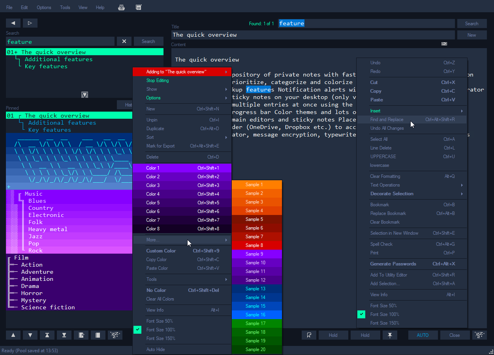

# AHOY!

**Encrypted notes for Windows.** AHOY! keeps all your notes in one password-encrypted file (AES-256-GCM), the *Pool*, with fast search, a pinned list with colors and categories, sticky notes on the desktop and automatic backups.

## Project status

AHOY! is in **maintenance mode**. My focus is now on [Marbles](https://github.com/artstisen/marbles), [Blyant](https://blyant-editor.com/) and [Lexetype](https://lexetype.com/), so AHOY! gets bug fixes but no new features.

You are welcome to fork AHOY! and build on it: it is MIT licensed, so you can change and share your own version. Bug reports are welcome under [Issues](../../issues). See [CONTRIBUTING.md](CONTRIBUTING.md).

## Related projects

- **[Marbles](https://github.com/artstisen/marbles)** is the cross-platform, modal terminal successor to AHOY!: encrypted notes in the terminal on Windows, Linux and macOS. Your AHOY! notes can be moved to it with *File -> Export to Marbles*.
- **[Blyant](https://blyant-editor.com/)** is a cross-platform, Vim-style modal text editor for writing and programming in the terminal, built on the same foundation as Marbles.
- **[Blyant Validator](https://github.com/artstisen/blyant-validator)** validates and formats HTML, CSS, XML and Markdown, side by side with your editor, in any terminal.
- **[Lexetype](https://lexetype.com/)** is a typewriter simulator that simulates electric and mechanical typewriters, featuring overtyping, ink consumption, and precise printing in DIN and Letter formats.



<sub>Screenshot from an earlier release. Some features and decorations shown have since been removed or simplified.</sub>

## Specifications

| | |
|---|---|
| Version | 2.0.0 |
| Platform | Windows 10 and 11 (x64) |
| Runtime | Included in the installer; the portable version needs the .NET 10 Desktop Runtime |
| Encryption | AES-256-GCM, key derived from your password with PBKDF2-HMAC-SHA256 (600,000 iterations) |
| Storage | One encrypted Pool file plus encrypted backups, in `%APPDATA%\Ahoy` (or a folder you choose) |
| Network | None: AHOY! never connects to the Internet |
| Themes | Dark, Light and Blue, with custom colors |
| License | MIT |

## Features

**Notes**
- Unlimited entries in one encrypted Pool, saved automatically
- Title and content search with live search as you type, plus search and replace inside an entry
- History (back/forward), two Hold buttons for switching between entries, bookmarks and global undo
- A memo field next to the pinned list

**Organizing**
- Pinned list with 8 quick colors, 20 color samples and custom colors
- Categories: group entries under a category entry and expand or collapse them in the pinned list
- Sorting, duplicating and marking entries for export

**Writing tools**
- Spell checker (uses the languages installed in Windows)
- Paragraph dividers, timestamps, text operations (sort, case, whitespace) and simple decorations (underline, bullets)
- Word and WPM counter
- Password generator and message encryption (encrypt a selected text to share it)

**Desktop**
- Sticky notes, saved in the Pool and restored on the right monitor
- Auto-lock after a period of inactivity, read-only mode, full screen and adjustable opacity
- Command prompt (Ctrl+Alt+A) and keyboard shortcuts for nearly everything; see Help -> Quick Guide

**Safety**
- Rotating local backups and an optional remote backup folder (for example a cloud-synced folder)
- Backup recovery, import/export of selected entries
- Export to [Marbles](https://github.com/artstisen/marbles) (File -> Export to Marbles)
- Unexpected errors are reported and logged instead of closing silently

## Security

Your password is the key to the Pool:

- The password is never stored. It is only used to derive the 256-bit encryption key (PBKDF2-HMAC-SHA256, 600,000 iterations, random 128-bit salt per Pool).
- The Pool is encrypted with AES-256-GCM, with a new random nonce on every save. The authentication tag covers the whole file, so any change or corruption is detected.
- **There is no password recovery.** If you forget your password, nobody can decrypt your notes, including the developer. Keep the password somewhere safe, for example in a password manager.

What is and isn't encrypted:

- **Encrypted:** the Pool and its backups, including entries, memo, sticky notes and the event log.
- **Not encrypted:** `Settings.xml` (window size, theme and similar preferences), entries you export, and `Crash.log` (error details only, never note content).

### Upgrading from AHOY! 1.x

AHOY! 1.x encrypted the Pool with a less secure method. The first time AHOY! 2.0 opens a 1.x Pool it will:

1. ask for your current password,
2. ask you to create a new password,
3. save the Pool in the new format and verify it,
4. offer to delete old-format backups from AHOY! 1.x.

If you cancel, the old Pool is left unchanged. Old copies kept elsewhere (cloud history, USB drives, the Recycle Bin) are not touched and should be deleted manually.

### Moving to Marbles

**File -> Export to Marbles (.mbls)** writes the open Pool as a new, encrypted [Marbles](https://github.com/artstisen/marbles) data file with a password of its own:

- every entry becomes a Marbles entry, with its dates and cursor position
- sticky notes and the memo become normal entries
- pinned entries stay pinned, in the same order and with the nearest console color
- locked entries become read-only
- categories and text bookmarks have no counterpart in Marbles and are left out

The Pool itself is not changed, and an existing file is never overwritten. Put the file in the Marbles data folder and log in with the new password.

## Download and run

Download from [Releases](../../releases):

| File | What it is |
|---|---|
| `Ahoy-2.0.0-setup-win-x64.exe` | **Installer** (about 50 MB). .NET is included, so nothing else needs to be installed. Installs for your user without administrator rights (or for all users, if you choose so), with a Start menu entry and an uninstaller. |
| `Ahoy-2.0.0-portable-win-x64.zip` | **Portable** (about 1 MB). Unzip anywhere and run `Ahoy.exe`. Needs the [.NET 10 Desktop Runtime](https://dotnet.microsoft.com/download/dotnet/10.0) (x64); if it is missing, AHOY! offers to open the download page the first time. |
| `SHA256SUMS.txt` | Checksums of the two files. |

Both versions keep your notes in the same place, so you can switch between them. Uninstalling never removes your notes.

### AHOY! is not code signed

The files are not code signed. The old code signing certificate has expired, and a new one costs more than makes sense for a free hobby project. Windows therefore can't tell who made the program, and **Microsoft Defender SmartScreen** may stop it the first time with a blue *"Windows protected your PC"* window. This is a warning about an unknown publisher, not a virus warning.

To run it anyway:

1. Check that the file is the real one: compare its checksum with `SHA256SUMS.txt` on the release page. In PowerShell:
   ```
   Get-FileHash .\Ahoy-2.0.0-setup-win-x64.exe
   ```
2. Start the file. If the blue window appears, click **More info**, then **Run anyway**.
3. For the portable version, unblock the zip **before** unzipping: right-click it, choose **Properties**, tick **Unblock** at the bottom and click **OK**. Otherwise every file in it carries the download warning.

If **Smart App Control** is turned on (Windows 11, *Windows Security -> App & browser control -> Smart App Control*), unsigned programs are blocked without a *Run anyway* button. AHOY! then only runs if Smart App Control is turned off. On some versions of Windows it can't be turned on again without reinstalling Windows, so read Microsoft's note on that page before you decide.

The source code is all here: you can read what the program does and build it yourself.

AHOY! stores its data in `%APPDATA%\Ahoy`. To use another folder, for example to try a copy of your Pool, start it with:

```
Ahoy.exe --data-dir "C:\Path\To\Folder"
```

## Build from source

Requirements: Windows and the [.NET 10 SDK](https://dotnet.microsoft.com/download).

```
dotnet build -c Release
dotnet test
```

Build the release files (portable zip, installer and checksums) in `publish\`. This runs the tests first and needs [Inno Setup 6](https://jrsoftware.org/isinfo.php) (`winget install JRSoftware.InnoSetup`):

```
.\build-release.ps1
```

Or publish by hand. A small build that needs the .NET 10 Desktop Runtime installed:

```
dotnet publish AhoyBrowser -c Release -r win-x64 --self-contained false
```

Or a single self-contained `Ahoy.exe` that needs no installed runtime (about 170 MB):

```
dotnet publish AhoyBrowser -c Release -r win-x64 --self-contained -p:PublishSingleFile=true -p:IncludeNativeLibrariesForSelfExtract=true
```

| Folder | Contents |
|---|---|
| `AhoyBrowser/` | The Windows Forms application |
| `AhoyBrowser/Crypto/` | Pool and message encryption, and the read-only reader for AHOY! 1.x Pools |
| `AhoyBrowser/Export/` | Export to Marbles |
| `AhoyBrowser.Tests/` | Tests for encryption, 1.x compatibility, saving, loading and upgrading Pools, and the Marbles export |
| `installer/` | Inno Setup script for the installer |

## What's new in 2.0

The full list is in the [changelog](CHANGELOG.md).

- Runs on .NET 10 (previously .NET Framework 4.8)
- Password-based AES-256-GCM encryption replaces 3DES with a built-in key
- Security question and password reset removed
- Leaner: Typewriter, Typermax, notifications, Utility/PLOP Editor, calculators, Roman numerals, random numbers, ANSI editor, Magic Screen Blocker, Prism effect, templates, the update checker and 17 color themes were removed
- Plain ASCII instead of extended ASCII and box-drawing characters: the category tree in the pinned list now uses `|`, `-`, `/` and `\`, text decorations and frames are simpler, and the home screen and animations are drawn instead of written in characters. These characters showed up wrong with some fonts and on East Asian (Japanese, Chinese, Korean) Windows, so AHOY! now looks right everywhere
- Export to Marbles (.mbls)
- Installer with .NET included, and a small portable version
- Fixes for Japanese/Chinese IME input in live search, sticky note positions on multiple monitors, and emoji being lost when saving

## License

[MIT](LICENSE) © 2019-2026 Lars Brandt Stisen
